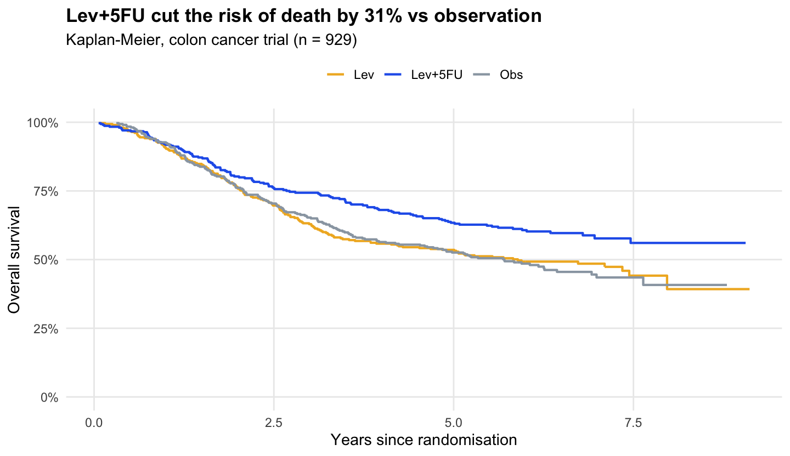
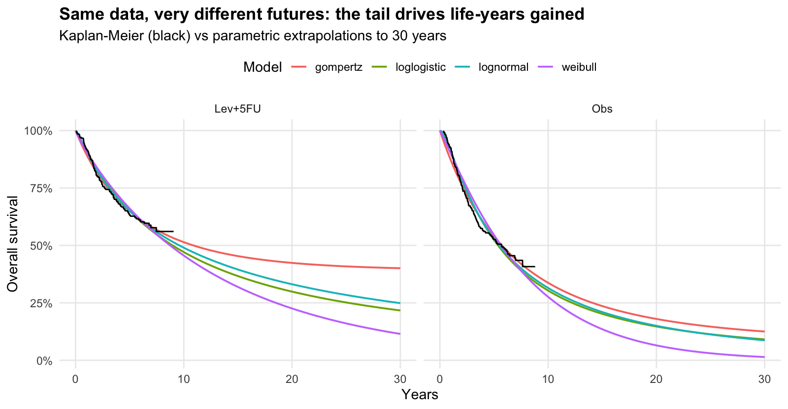
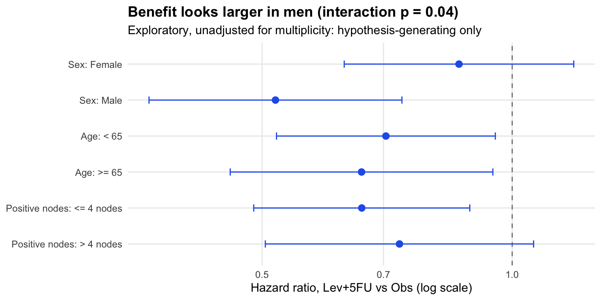
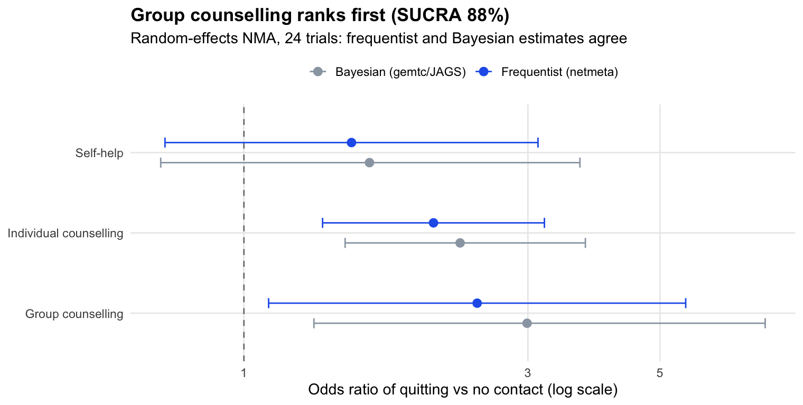

# Survival extrapolation and network meta-analysis for health technology assessment


**Live app:** _add your Streamlit link here_ · **Stack:** R (survival, flexsurv, netmeta, gemtc + JAGS/BUGS), testthat,
Excel model (openpyxl), Streamlit, GitHub Actions

Two analyses that sit behind almost every NICE submission, done end to end in R from a pre-written
[statistical analysis plan](SAP.md):

1. **How much longer do patients live on a new treatment?** Survival analysis of a 929-patient colon cancer trial,
   extrapolated beyond trial follow-up to estimate life-years gained.
2. **Which intervention works best when no single trial compares them all?** Frequentist and Bayesian network
   meta-analysis of 24 smoking-cessation trials.



## The problem I solved
Reimbursement bodies such as NICE decide on costs per life-year, but trials stop after a few years and rarely compare
every option head to head. A statistician therefore has to (a) extrapolate survival curves far beyond the data, and
(b) combine direct and indirect evidence from many trials. Both are judgement-heavy, and both can swing a decision.

## The process I optimised
| Usually | Here |
|---|---|
| Analysis decisions made as the work goes | A **statistical analysis plan written first** ([SAP.md](SAP.md)), with deviations recorded afterwards |
| One "best" extrapolation picked by AIC alone | **Six distributions per arm** compared on AIC/BIC, visual fit *and* plausibility, and the spread of results shown openly |
| Frequentist or Bayesian NMA | **Both**, with convergence checks (Gelman–Rubin), DIC model choice, node-splitting for inconsistency, and the results compared |
| Survival model rebuilt by hand in Excel | **Excel model generated from the R estimates** (model selector, monthly cycles, life-years), checked to match R within 1% |
| Results checked by eye | **10 automated tests** (8 in R, 2 in Python), including one that reproduces the published NICE DSU TSD 2 example, run on every push |

## The results I got
### 1. Survival (colon cancer, 929 patients)
| Arm | Patients | Deaths | Median survival | 5-year survival |
|---|---|---|---|---|
| Observation | 315 | 168 | 5.7 years (4.5–7.6) | 52.6% |
| Levamisole | 310 | 161 | 5.9 years | 53.5% |
| Levamisole + 5-FU | 304 | 123 | not reached | **63.4%** |

- **Lev+5FU cut the risk of death by 31%**: HR 0.69 (95% CI 0.55–0.87, p = 0.002); 0.68 (0.54–0.87) after adjusting
  for 8 prognostic factors. Levamisole alone had no effect (HR 0.97, 0.78–1.21).
- Proportional hazards held for treatment (Schoenfeld p = 0.28).



**Extrapolation is where the judgement lies.** All six models fit the 8 years of data well, but over 30 years they
give **2.9 to 5.8 life-years gained**. AIC favours the generalised gamma for observation and the log-normal for Lev+5FU.
I chose **log-normal for both arms** as the base case: it's the best fit for the treated arm, the second best for
observation (ΔAIC 9), and using one family across arms keeps the comparison consistent (NICE DSU TSD 14).
Base case: **9.1 vs 13.7 mean life-years, a gain of 4.6 life-years**, with the Gompertz (5.8) and generalised gamma
(2.9) as scenario analyses.

**Subgroups (exploratory).** Benefit looked larger in men (HR 0.52, 0.37–0.74) than in women (0.86, 0.63–1.19);
interaction p = 0.04. With three subgroup tests and no multiplicity adjustment, this is a hypothesis to test, not a
reason to treat men and women differently.



### 2. Network meta-analysis (24 trials, 4 interventions)
| Odds ratio of quitting vs no contact | Frequentist (95% CI) | Bayesian (95% CrI) | SUCRA |
|---|---|---|---|
| Self-help | 1.52 (0.74–3.12) | 1.62 (0.76–3.67) | 39% |
| Individual counselling | 2.08 (1.36–3.20) | 2.31 (1.49–3.83) | 69% |
| **Group counselling** | **2.47 (1.10–5.52)** | **2.99 (1.29–7.27)** | **88%** |



- **Group counselling ranks first** (71% probability of being best), then individual counselling. Self-help is not
  clearly better than no contact.
- **Heterogeneity is high** (I² = 89%; Bayesian between-study SD 0.82 on the log-odds scale), so random effects are
  essential: DIC 97.6 against 294.0 for fixed effects, and residual deviance 53.9 for 50 data points.
- **Consistency:** the global design-by-treatment test is borderline (p = 0.03), but no node-split shows direct and
  indirect evidence disagreeing (all p > 0.27).
- **Validated:** the Bayesian log odds ratios (0.49, 0.84, 1.10) and SD (0.82) reproduce the published NICE DSU
  TSD 2 worked example; a test checks this on every run. All chains converged (Gelman–Rubin ≤ 1.002).

### Recommendations (as I would write them for a client)
1. Base the economic model on the log-normal extrapolation (**4.6 life-years gained**) and present the Gompertz and
   generalised gamma as scenarios, because the choice moves the result by up to 1.6 life-years.
2. Add general-population mortality to the extrapolation before submission, so no curve implies patients outlive
   people of the same age without cancer.
3. Treat the sex interaction as a hypothesis for future trials, not a basis for restricting treatment.
4. For smoking cessation, prioritise group then individual counselling, and report the ranking with its uncertainty:
   the credible intervals overlap.

## Limitations
- `colon` is a 1980s trial; it shows the methods, not current practice.
- No background mortality, cure models or spline models (Royston–Parmar) yet: the natural next steps.
- Covariate proportional-hazards violations (differentiation, obstruction, nodes) weren't addressed with stratification.
- The NMA uses study-level data, so effect modifiers can't be adjusted for (network meta-regression would need covariates).

## How to run
```bash
# R 4.5 with JAGS installed (brew install jags, or conda install -c conda-forge jags r-rjags)
Rscript -e 'install.packages(c("survival","flexsurv","netmeta","gemtc","rjags","testthat","ggplot2"))'
Rscript analysis/01_survival.R        # -> outputs/, screenshots/01-03
Rscript analysis/02_nma.R             # -> outputs/, screenshots/04-06 (about 1 minute of MCMC)
Rscript -e 'testthat::test_dir("tests/testthat")'
pip install -r requirements.txt
python excel/build_model.py           # -> excel/survival_extrapolation_model.xlsx
streamlit run app.py
```

## Repo map
[`SAP.md`](SAP.md) analysis plan · `R/` functions · `analysis/` scripts · `outputs/` every number in this README ·
`excel/` Excel model · `tests/` testthat + pytest · [`data/README.md`](data/README.md) sources and licences
